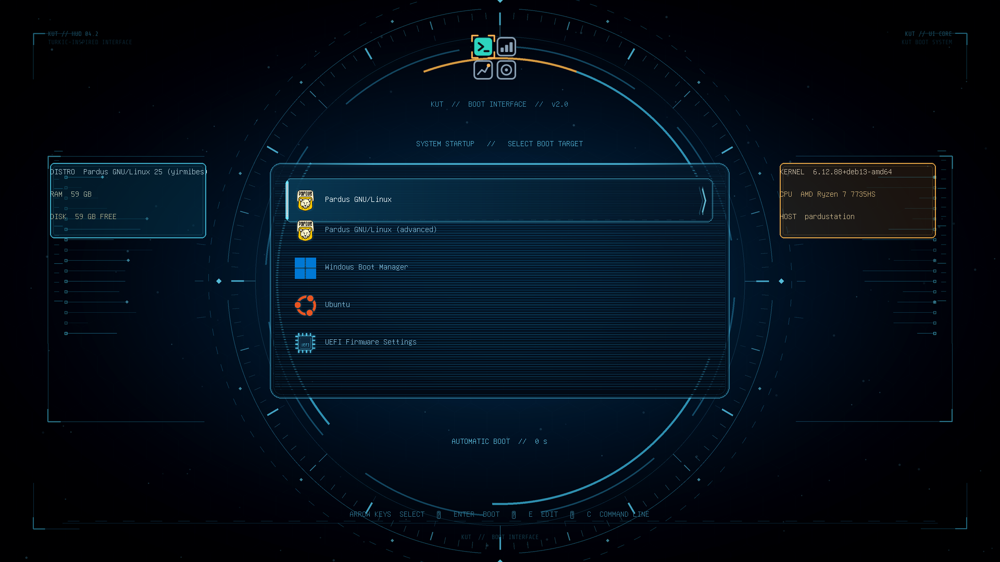

  

  A GRUB theme that presents live machine information in the boot menu.

Kut brings the selected boot target, distribution icons, and machine metadata
into one interface. Its name comes from the Old Turkic concept of “kut”.

## Highlights

- A menu layout designed for 1080p and compatible with GRUB-supported fallback
  resolutions
- A template that refreshes distribution, kernel, RAM, firmware, host, and CPU
  information at installation time and on every <code>update-grub</code> run
- An optional pre-menu telemetry screen using SMBIOS information
- Icon mappings for Linux, Pardus, Windows, macOS, and other common boot entries
- A conservative installer and uninstaller with timestamped backups of the
  existing GRUB configuration and theme files

## Install

Clone the repository, then run the installer with administrator privileges:

~~~bash
git clone https://github.com/alihaydarsucu/kut.git kut
cd kut
sudo ./install.sh
~~~

The installer backs up the current configuration under
<code>/var/backups/kut-grub/&lt;timestamp&gt;</code> and then regenerates the GRUB
configuration. See the [installation guide](https://github.com/alihaydarsucu/kut/blob/main/docs/installation.md) for details.

## Uninstall

~~~bash
sudo ./uninstall.sh
~~~

This removes only Kut's theme, hooks, and settings, and creates a separate
backup before doing so.

## Documentation

- [Installation and configuration](https://github.com/alihaydarsucu/kut/blob/main/docs/installation.md)
- [Brand assets](https://github.com/alihaydarsucu/kut/blob/main/docs/brand.md)
- [Documentation index](https://github.com/alihaydarsucu/kut/tree/main/docs)

## Preview

This is a real 1920×1080 GRUB menu capture from a QEMU/OVMF boot, built with
the committed theme files and representative Linux, Windows, UEFI, and memory
test menu entries.
